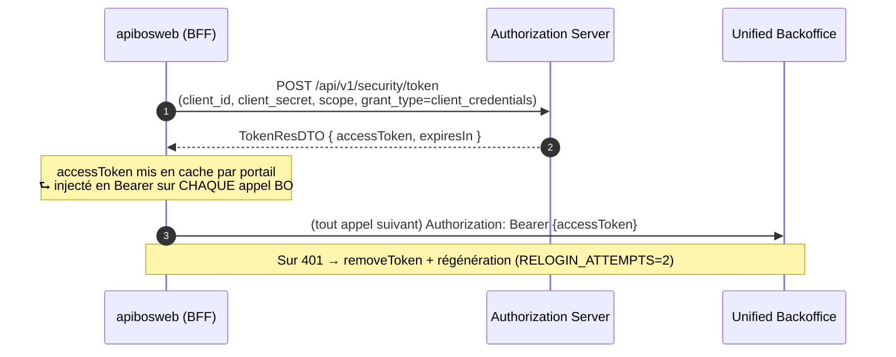
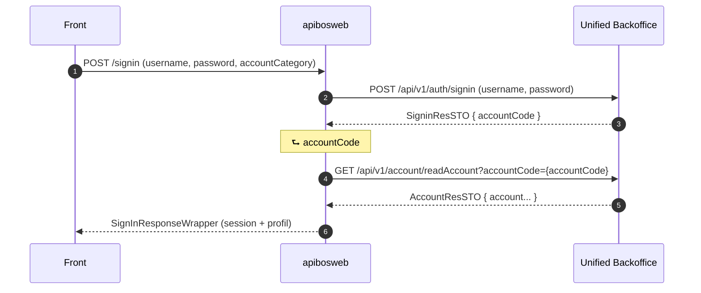
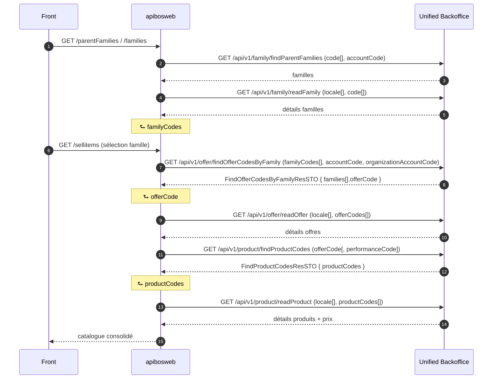
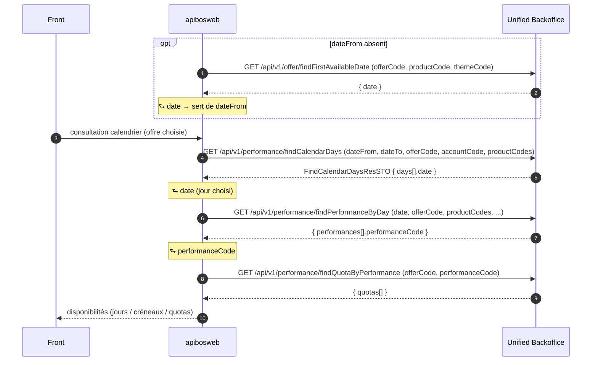
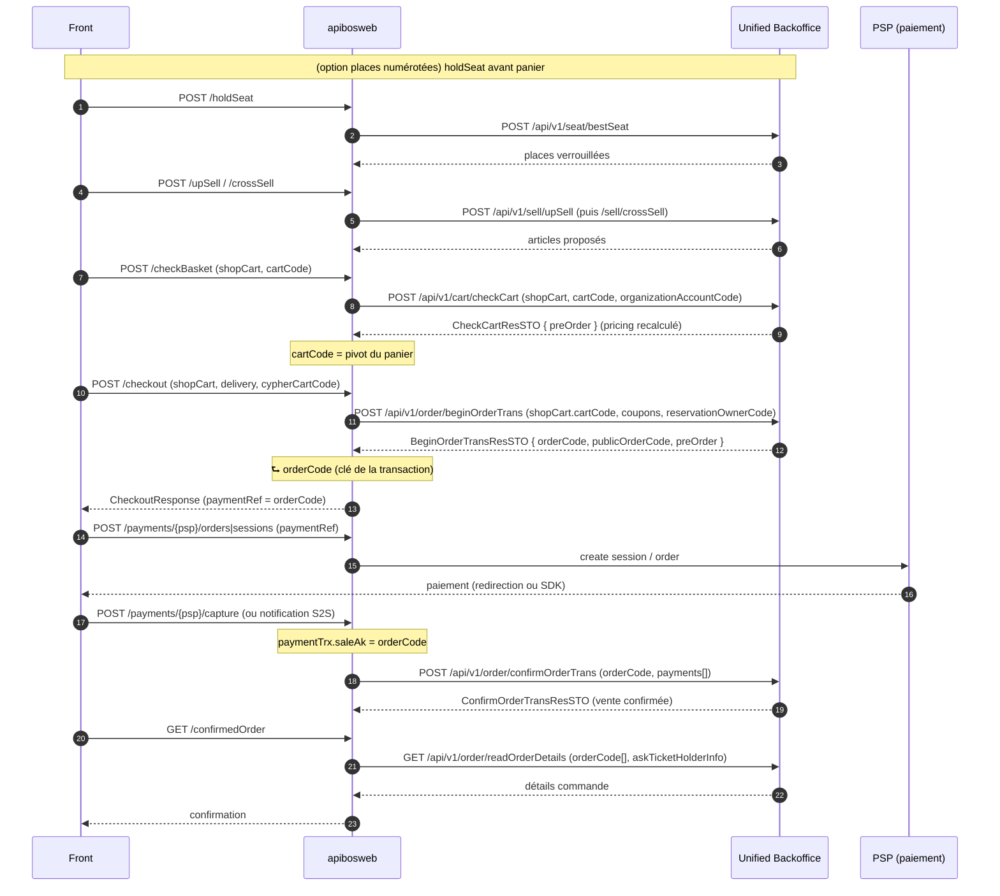
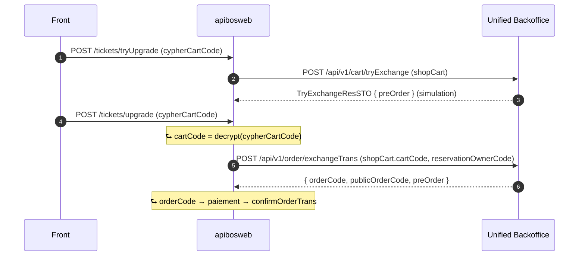
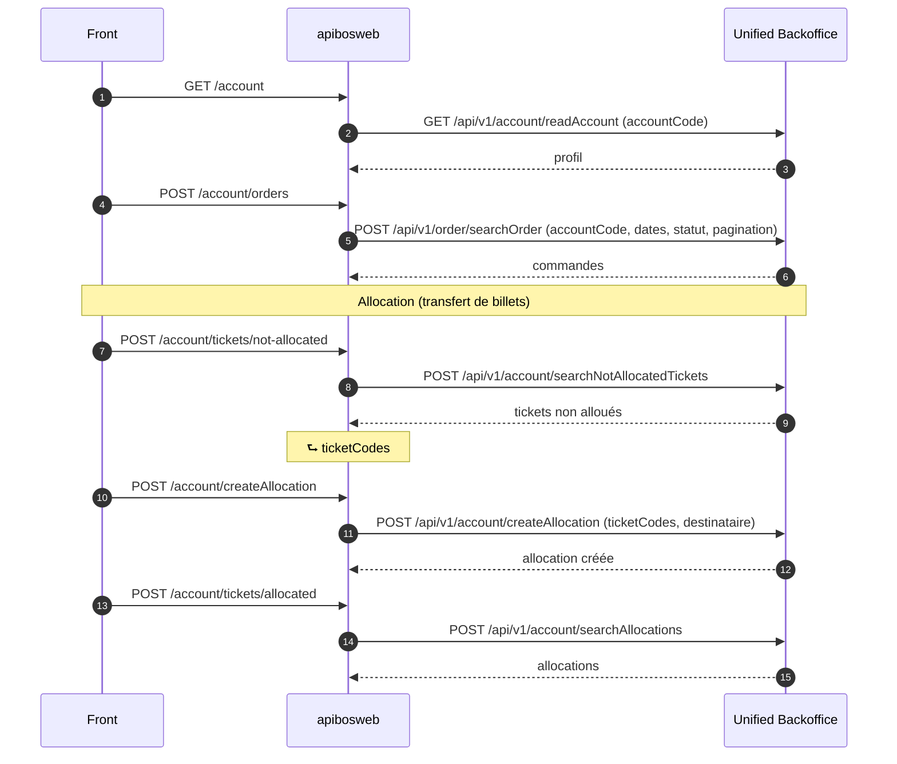
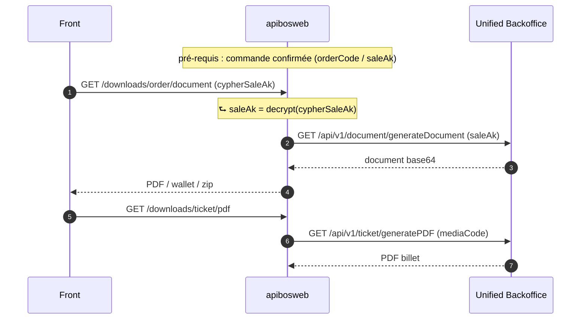
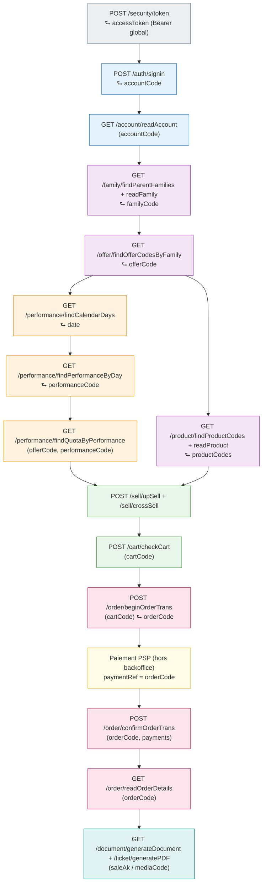

# Flux d'utilisation des routes API backoffice par parcours front

**Source API** : `unified-backoffice-api.yaml` **v1.11.16** (repo `web3-common-main`, module `back-end/apibosweb`).
**Rôle du back-end** : BFF. Il expose l'API `web3-fe.yaml` au front et **consomme** l'API unified-backoffice.

Chaîne d'appel interne pour chaque opération :
`Front → *ApiController → <Action>.exec() → CallXxx → GateXxx → <Api généré> → route backoffice`

> **Vue d'ensemble visuelle** : voir [`flux-api-backoffice.svg`](./flux-api-backoffice.svg) (carte unique de tous les parcours et du chaînage de données).

> **Convention des diagrammes** : chaque flèche vers « BO » est une route backoffice réelle (méthode + chemin).
> Les annotations `⮑ data` indiquent **la donnée d'une réponse réinjectée dans l'appel suivant**.

---

## 0. Préalable commun à TOUS les appels — le token

Avant tout appel métier, le back obtient (et met en cache) un token OAuth2 sur le serveur d'autorisation (spec séparée `authorization-server-api`).

Chaînage : `token.accessToken` ⮑ en-tête `Authorization` de tous les appels ci-dessous. Implémenté dans `ApiClientFactory.getSecurityToken` + `GateUnified.callBO`.

---

## 1. Authentification (login)

Flow front : `POST /signin` → `AuthenticationApiController.signin` → `Signin.exec` → `CallAuth.signin`.

**Chaînage** : `signin.accountCode` ⮑ `readAccount(accountCode)`. (`CallAuth.signin`, lignes ~57-66.)

Réinitialisation mot de passe (hors login) :
`searchLoginAccount` ⮑ `accountCode` ⮑ `POST /auth/resetPassword` → `temporaryPassword` (déchiffré).

---

## 2. Consultation du catalogue (familles → offres → produits)

Flow front : `GET /parentFamilies`, `/families`, `/sellitems` → contrôleurs `FamilyApiController` / `SellItemApiController` / `ProductApiController`.

**Chaînage** :
`findParentFamilies/readFamily.familyCode` ⮑ `findOfferCodesByFamily` → `offerCode` ⮑ `readOffer` **et** `findProductCodes` → `productCodes` ⮑ `readProduct`.

---

## 3. Calendrier de disponibilité (jours → créneaux → quotas)

Flow front : `GET /events/calendar`, `POST /dayPerformance`, `GET /performances/{ak}` → `SellItemApiController` → `CallPerformance`.

**Chaînage (le plus profond du projet)** :
`findFirstAvailableDate.date` ⮑ `findCalendarDays.dateFrom` → `days[].date` ⮑ `findPerformanceByDay.date` → `performances[].performanceCode` ⮑ `findQuotaByPerformance(offerCode, performanceCode)`.
(`CallPerformance.searchCalendarAvailability` / `GatePerformance`.)

---

## 4. Tunnel d'achat (panier → commande → paiement → confirmation)

C'est le parcours central. Flow front : `/upSell`, `/crossSell`, `/checkBasket`, `/checkout`, puis `/payments/...`, puis `/confirmedOrder`.

**Chaînages clés** :
1. `cartCode` (produit/chiffré au checkout) ⮑ `checkCart.shopCart.cartCode` **et** `beginOrderTrans.shopCart.cartCode`.
2. `beginOrderTrans.orderCode` (= `paymentTrx.saleAk`) ⮑ `confirmOrderTrans.orderCode`. (`CallOrder.checkout` ~246-300 et `closeOrder` ~335-345.)
3. `orderCode` ⮑ `readOrderDetails(orderCode[])` pour la confirmation.

> Annulation avant paiement : `POST /order/cancelOrderTrans(orderCode)` et/ou `DELETE /cart/removeCart?cartCode={cartCode}`.

---

## 5. Variante : upgrade / renouvellement de billets

Flow front : `/tickets/tryUpgrade` → `/tickets/upgrade` (idem renew). Même logique que le tunnel, avec `cypherCartCode` déchiffré.

**Chaînage** : `cypherCartCode` ⮑ (déchiffré) `cartCode` ⮑ `exchangeTrans`/`renewalTrans` → `orderCode` ⮑ même suite paiement + `confirmOrderTrans` qu'au flow 4. (Renew utilise `POST /order/renewalTrans`.)

---

## 6. Espace client (compte, commandes, allocations)

Flow front : `UserApiController` (`/account`, `/account/orders`, `/account/createAllocation`...).

**Chaînage** : `searchNotAllocatedTickets.ticketCodes` ⮑ `createAllocation`.
`readAccount.accountCode` ⮑ `searchOrder(accountCode)`.

---

## 7. Documents / billets (après commande confirmée)

Flow front : `FileApiController` (`/downloads/ticket/pdf`, `/downloads/order/document`...).

**Chaînage** : `confirmOrderTrans/searchOrder` fournit `saleAk`/`mediaCode` ⮑ `generateDocument(saleAk)` / `generatePDF(mediaCode)`.

---

## Synthèse — séquence nominale d'achat de bout en bout

---

## Tableau récapitulatif des chaînages de données inter-routes

| # | Donnée pivot | Produite par (route) | Consommée par (route) |
|---|--------------|----------------------|------------------------|
| 1 | `accessToken` | `POST /security/token` | en-tête `Bearer` de **tous** les appels BO |
| 2 | `accountCode` | `POST /auth/signin` | `GET /account/readAccount`, `POST /order/searchOrder` |
| 3 | `familyCode` | `GET /family/findParentFamilies` | `GET /offer/findOfferCodesByFamily` |
| 4 | `offerCode` | `GET /offer/findOfferCodesByFamily` | `readOffer`, `findProductCodes`, `findCalendarDays`, `findQuotaByPerformance` |
| 5 | `productCodes` | `GET /product/findProductCodes` | `GET /product/readProduct` |
| 6 | `date` | `findFirstAvailableDate` / `findCalendarDays` | `findCalendarDays.dateFrom` / `findPerformanceByDay.date` |
| 7 | `performanceCode` | `GET /performance/findPerformanceByDay` | `GET /performance/findQuotaByPerformance` |
| 8 | `cartCode` | checkout front (chiffré) | `cart/checkCart`, `order/beginOrderTrans`, `cart/removeCart`, exchange/renewal |
| 9 | `orderCode` | `POST /order/beginOrderTrans` (= `paymentTrx.saleAk`) | `POST /order/confirmOrderTrans`, `GET /order/readOrderDetails` |
| 10 | `saleAk` / `mediaCode` | `confirmOrderTrans` / `searchOrder` | `document/generateDocument`, `ticket/generatePDF` |
| 11 | `cypherCartCode` → `cartCode` | front (déchiffré par le BFF) | `order/exchangeTrans`, `order/renewalTrans` |
| 12 | `ticketCodes` | `POST /account/searchNotAllocatedTickets` | `POST /account/createAllocation` |

---

### Fichiers de référence (repo tiers)
- `back-end/apibosweb/openapi/unified-backoffice-api.yaml` (v1.11.16) — définition des routes BO.
- `.../be/unified/call/CallAuth.java`, `CallOrder.java`, `CallPerformance.java`, `CallCart.java`, `CallOffer.java` — orchestration + chaînage.
- `.../be/unified/request/FactoryOrder.java` — construction des requêtes (noms de champs du chaînage).
- `.../be/unified/gate/GateUnified.java`, `base/ApiClientFactory.java` — token + exécution + retry 401.
- `src/main/java/com/omniticket/api/controller/api/*ApiController.java` — mapping flows front → actions.
